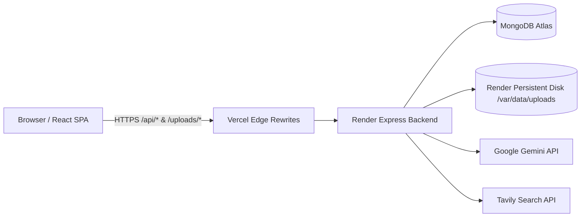

# System Architecture

## Overview

## End-to-End Data Flow

1. **Source Collection:** Users upload PDFs/images (Multer -> `config.storage.uploadDir/<projectId>/<uuid>.<ext>`) or submit URLs (validated by `ssrfProtection.js`).
2. **Extraction & Relevance:** `sourceWorker.js` verifies file existence with `fs.access`, extracts text (`pdf-parse` or Gemini Vision), and runs `assessSourceRelevance()` against the target business identity/location. Only `relevant` sources import facts.
3. **Fact Normalization & Verification:** Extracted facts are stored in `Fact` documents with `candidates[]` (preserving `sourceId`, `sourceURL`, `evidenceExcerpt`, `extractionMethod`). Owners confirm, reject, or resolve conflicts on the Verification screen.
4. **Website Generation:**
   - *Normal mode:* `generation.controller.js` loads confirmed facts, builds an XML-delimited prompt, calls Gemini (`generateJSON`), and validates with Zod (`validateWebsiteJSON`).
   - *Manual-only mode:* Uses `buildManualOnlyContext()` + `buildDeterministicManualWebsite()` + `sanitizeManualOnlyWebsite()`, persisting `approvedFactsSnapshot` on the `Website` document.
5. **Editing & Publishing Gate:** Owners edit sections/theme in the Editor. `publishing.controller.js` validates enabled sections against `findUnsupportedClaims()` and fact/source guards before creating an immutable `WebsiteVersion` snapshot.
6. **Public Renderer:** `GET /api/public/sites/:slug` serves only the published `WebsiteVersion` snapshot.
